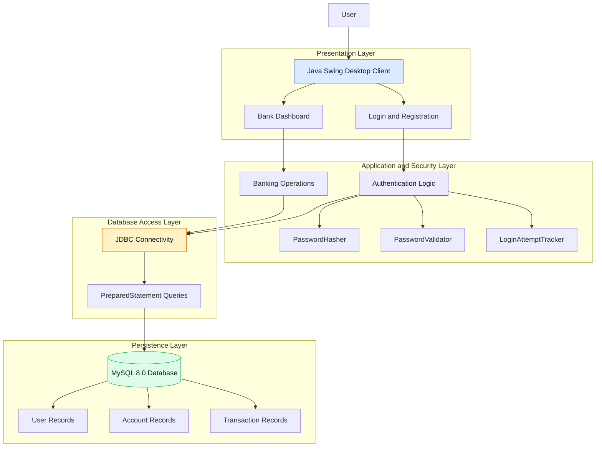

# 🚀 NovaBank Management System

> A secure, modern desktop banking application built with **Java Swing, JDBC, and MySQL**, featuring BCrypt password hashing, authentication security controls, password strength validation, transaction management, and a modern fintech-inspired user interface.

---

## 📌 Overview

The **NovaBank Management System** is a Java-based desktop banking application designed to demonstrate core banking operations, relational database management, and secure software development practices.

The application provides a graphical interface for user authentication, account management, deposits, withdrawals, fund transfers, and transaction history. It integrates MySQL for persistent data storage and JDBC for database communication.

The project emphasizes security-conscious development through password hashing, password validation, login attempt tracking, and parameterized SQL queries.

### 🎯 Objectives

- Implement essential banking operations in a desktop application.
- Apply secure authentication and credential storage practices.
- Prevent common database attacks through parameterized queries.
- Maintain structured account and transaction records.
- Develop a clean, intuitive, and maintainable user interface.
- Demonstrate the practical application of cybersecurity and DBMS concepts.

---

## ✨ Key Features

### 🔒 1. Cybersecurity and Authentication

- **BCrypt Password Hashing:** Uses the JBCrypt library to hash passwords with unique salts and a configurable computational work factor.
- **Legacy Credential Migration:** Supports upgrading legacy credentials to BCrypt after successful authentication, where implemented.
- **Password Policy Enforcement:** Validates password strength through length requirements, character composition rules, heuristic checks, and common-password checks, according to the configured policy.
- **Brute-Force Mitigation:** Tracks failed login attempts and applies a temporary cooldown or lockout after three consecutive failures, according to the implemented logic.
- **SQL Injection Prevention:** Uses JDBC `PreparedStatement` for parameterized database queries.
- **Input Validation:** Validates user inputs before processing authentication and banking operations.

### 💳 2. Banking Operations

- User registration and login.
- Account and balance management.
- Deposits and withdrawals.
- Fund transfers.
- Transaction history and recent activity.
- Database-backed account information.

### 🎨 3. Modern Fintech User Interface

- Split-screen authentication interface.
- Login and registration forms.
- Show/hide password functionality.
- Live password strength feedback, where implemented.
- Card-based banking dashboard.
- Quick-action interface for banking operations.
- Color-coded transaction activity:
  - 🟢 Green for credits and deposits.
  - 🔴 Red for debits and withdrawals.
- Light and dark theme support, where implemented.

### 🗄️ 4. Database Management

- MySQL-backed persistent storage.
- Relational database design.
- Primary and foreign key relationships, where configured.
- Transaction records with timestamps, where implemented.
- JDBC-based database connectivity.
- Parameterized SQL queries for database operations.

---

## 🏗️ System Architecture

NovaBank follows a client-server model with an MVC-like separation of user interface, application logic, database connectivity, and persistence responsibilities.



### Architecture Components

| Component | Responsibility |
|---|---|
| Java Swing UI | Displays authentication forms, dashboard, and transaction information |
| Authentication Logic | Handles credential verification and login flow |
| `PasswordHasher.java` | Provides password hashing and verification functionality |
| `PasswordValidator.java` | Validates passwords against the configured policy |
| `LoginAttemptTracker.java` | Tracks failed login attempts and applies configured restrictions |
| Banking Operations | Processes deposits, withdrawals, and transfers |
| JDBC | Connects Java application components to MySQL |
| `PreparedStatement` | Executes parameterized SQL queries |
| MySQL 8.0 | Stores application data persistently |

*Note: The diagram represents the intended logical architecture. Adjust component names and relationships to match the actual source code.*

---

## 🛠️ Tech Stack

| Technology | Purpose |
|---|---|
| Java 17+ | Application logic |
| Java Swing | Desktop GUI |
| MySQL 8.0 | Relational database |
| JDBC | Database connectivity |
| JBCrypt (`jbcrypt-0.4.jar`) | BCrypt password hashing |
| MySQL Workbench | Database administration |
| Git and GitHub | Version control and source code hosting |

---

## 📂 Project Structure

The following is an illustrative structure. Update it to match the actual repository.

```text
NovaBank-Management-System/
│
├── src/
│   ├── LoginFrame.java
│   ├── BankDashboard.java
│   ├── PasswordHasher.java
│   ├── PasswordValidator.java
│   ├── LoginAttemptTracker.java
│   └── Database.java
│
├── lib/
│   └── jbcrypt-0.4.jar
│
├── schema.sql
├── README.md
└── .gitignore
```

---

## 📸 Application Screenshots

Add screenshots of the actual running application to showcase its interface and functionality.

### Authentication Interface

<!-- Replace the path below with the actual screenshot path in your repository. -->


### Banking Dashboard


### Transaction Activity


### Database Schema


> **Note:** Place your screenshots in a `screenshots/` directory at the repository root, or update the image paths to match their actual locations. Remove any screenshot placeholder for a feature that has not been implemented.

---

## ⚙️ Installation and Setup

### Prerequisites

Ensure the following software is installed:

- Java Development Kit (JDK) 17 or later.
- MySQL Server 8.0.
- MySQL Workbench (optional, but recommended).
- An IDE such as IntelliJ IDEA, Eclipse, or VS Code with Java support.
- MySQL Connector/J JDBC driver.
- JBCrypt library: `jbcrypt-0.4.jar`.

### Step 1: Clone the Repository

Open a terminal and run:

```bash
git clone https://github.com/perryplatypus06/NovaBank-Management-System.git
cd NovaBank-Management-System
```

### Step 2: Create the Database

Start MySQL and execute:

```sql
CREATE DATABASE IF NOT EXISTS novabank;

USE novabank;
```

If the repository contains a `schema.sql` file with the complete database definition, execute that file to create the tables, indexes, constraints, and other required objects.

For example, from a terminal:

```bash
mysql -u root -p novabank < schema.sql
```

Enter your MySQL password when prompted.

**Important:** The two database creation statements above do not create the application tables. The complete schema must be provided by `schema.sql` or the corresponding database setup instructions.

### Step 3: Configure Database Connectivity

Locate the database connection utility in the source code. If the project uses `Database.java`, update its connection configuration to match your local MySQL installation.

Example:

```java
private static final String URL =
    "jdbc:mysql://localhost:3306/novabank";

private static final String USER = "root";

private static final String PASSWORD =
    System.getenv("NOVABANK_DB_PASSWORD");
```

Set the `NOVABANK_DB_PASSWORD` environment variable to your local MySQL password before launching the application.

**Security note:** This configuration is an example. Adapt it to the actual connection class and variable names in the repository. Do not commit database passwords, API keys, or other secrets to GitHub.

### Step 4: Configure the Required Libraries

Ensure that the project has access to:

- MySQL Connector/J.
- `jbcrypt-0.4.jar`.

If using an IDE, add the JAR files to the project's library dependencies or configure them through the project's build system.

If the repository uses Maven or Gradle, follow the existing dependency configuration instead of adding duplicate JAR dependencies manually.

### Step 5: Run the Application

Open the project in your Java IDE, locate its main application class, and run it using JDK 17 or later.

The exact entry-point class depends on the current source code.

If the project uses a standalone Java compilation workflow, compile and launch it with the appropriate classpath containing the compiled classes and required libraries.

---

## 🔐 Security Implementation

### 1. BCrypt Password Hashing

BCrypt is designed for password storage and verification. It incorporates a salt and configurable computational cost into the hashing process.

Benefits include:

- Reduces the usefulness of precomputed rainbow tables.
- Makes large-scale offline password guessing more computationally expensive.
- Avoids storing passwords in plaintext when implemented correctly.
- Supports verification without decrypting the stored hash.

### 2. Password Validation

The password validation component checks credentials against the configured password policy.

Possible checks include:

- Minimum password length.
- Character composition requirements.
- Common-password blacklist checks.
- Heuristic detection of predictable patterns.
- Password strength feedback during registration.

### 3. Login Attempt Tracking

The login attempt tracker helps mitigate automated password guessing by limiting repeated failed authentication attempts.

The configured policy applies a temporary cooldown or lockout after three consecutive failures. If tracking is stored only in memory, its state may not survive application restarts or coordinate across multiple application instances.

### 4. SQL Injection Prevention

Parameterized queries help prevent SQL injection by keeping SQL instructions separate from user-supplied values.

Example:

```java
String sql =
    "SELECT user_id FROM users WHERE username = ?";

PreparedStatement pstmt =
    connection.prepareStatement(sql);

pstmt.setString(1, username);

ResultSet rs = pstmt.executeQuery();
```

Use the actual table and column names defined by the database schema.

### 5. Transaction Integrity

Deposits, withdrawals, and fund transfers require validation and consistent database updates.

A robust implementation should use database transactions where multiple related changes must succeed or fail together. It should also validate transaction amounts, check account permissions, and prevent inconsistent balances during concurrent operations.

---

## 🗃️ Database Verification Queries

The following queries are examples. Run them only after confirming that the referenced tables and columns exist in the actual schema.

### View Users

```sql
SELECT *
FROM users;
```

Avoid displaying password hashes or other sensitive fields when they are not needed.

### View Account Information

If the database uses `users.user_id` and `accounts.user_id` as a foreign-key relationship:

```sql
SELECT
    u.username,
    a.account_number,
    a.balance
FROM users AS u
JOIN accounts AS a
    ON u.user_id = a.user_id;
```

### View Recent Transactions

If the transaction table contains the illustrative columns shown below:

```sql
SELECT *
FROM transactions
ORDER BY transaction_timestamp DESC
LIMIT 10;
```

Replace `transaction_timestamp` with the actual timestamp column in your schema.

### Inspect Table Definitions

```sql
DESCRIBE users;

DESCRIBE accounts;

DESCRIBE transactions;
```

These commands help verify the actual database structure before running queries or troubleshooting application errors.

---

## 🧪 Testing and Verification

The following test scenarios can be used to evaluate the application.

| Test scenario | Expected result |
|---|---|
| Register with valid credentials | Account registration succeeds |
| Register with an invalid password | Password policy validation rejects the input |
| Log in with valid credentials | Authentication succeeds |
| Log in with an incorrect password | Authentication fails safely |
| Exceed the configured failed-login threshold | Temporary restriction is applied according to the implementation |
| Submit SQL metacharacters in an input field | Input is treated as data in parameterized queries |
| Deposit a valid amount | Balance and transaction records are updated consistently |
| Attempt an invalid withdrawal | Invalid operation is rejected |
| Transfer funds between accounts | Transfer is processed consistently, subject to validation |
| Inspect transaction history | Authorized users can view the relevant recorded activity |

These are recommended test cases, not a claim that every scenario has already passed. Record actual outcomes when testing the application.

---

## ⚠️ Limitations

NovaBank is an educational desktop banking project and is not intended for production financial deployment without further security engineering and independent validation.

Potential limitations include:

- In-memory login tracking may be lost when the application restarts.
- A local desktop deployment does not provide the security boundaries of a hardened, centrally managed banking platform.
- Password hashing does not protect against phishing, keylogging, or compromised endpoints.
- Prepared statements do not replace authorization checks or transaction validation.
- Database transaction handling must be verified to ensure consistency during failures and concurrent operations.
- Production use would require stronger monitoring, access controls, secure configuration, backup and recovery procedures, and security testing.

---

## 🚀 Future Enhancements

- Multi-factor authentication.
- Centralized authentication rate limiting.
- Role-based access control.
- Improved transaction reconciliation and audit logging.
- Secure password-reset workflows.
- Automated unit and integration tests.
- Database backup and recovery support.
- Improved accessibility and user feedback.
- Dependency scanning and automated security checks.
- Secure deployment and configuration management.

---

## 🎓 Learning Outcomes

This project demonstrates the practical application of:

- Java object-oriented programming.
- Desktop GUI development with Swing.
- JDBC and relational database integration.
- SQL queries and relational database design.
- Password hashing and authentication security.
- SQL injection prevention.
- Input validation and defensive programming.
- Banking transaction workflows.
- User interface design and transaction history presentation.
- Version control using Git and GitHub.

---

## 👩‍💻 Author

**Mahati Lokegaonkar**

Computer Engineering Student

GitHub: [@perryplatypus06](https://github.com/perryplatypus06)

---

## 📄 License

Add a license to the repository if you intend to distribute or reuse the project publicly. Until a license is included, the repository's default legal permissions remain limited.

---

*NovaBank Management System — An academic project exploring secure desktop banking, database management, and cybersecurity principles.*
